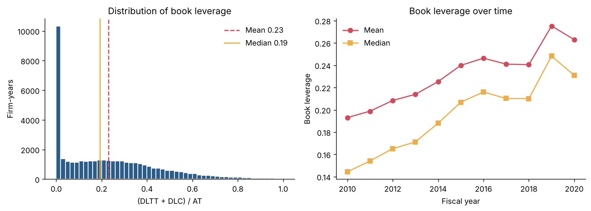
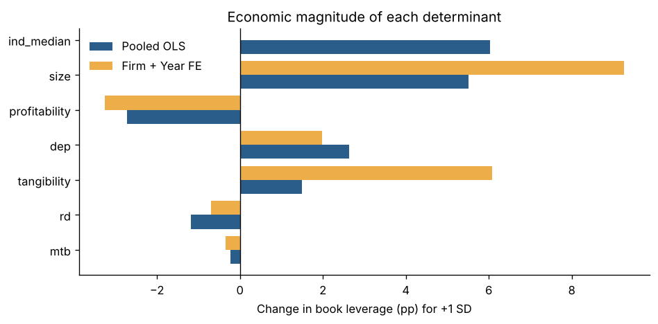
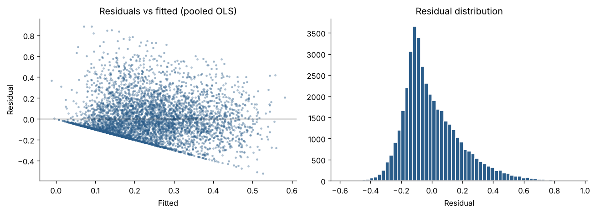

# Determinants of Corporate Leverage

An empirical study of what drives corporate debt ratios, using an unbalanced panel of 41,714 firm-years (6,937 U.S. non-financial firms, 2010–2020) from Compustat.

**Research question:** Which firm characteristics explain how much debt a firm carries relative to its assets? And how much of the variation in leverage do observable characteristics actually explain, compared with persistent differences between firms?

**Headline results**

- **Firm size is the strongest firm-level determinant.** A one-standard-deviation increase in log assets is associated with 9.3 pp more book leverage within firms.
- **Profitability is negative in every specification**, including within firms, even though its raw correlation with leverage is positive. This supports the pecking-order theory.
- **Leverage is mostly a persistent firm-specific trait.** Firm fixed effects raise R² from 0.24 to 0.80, while within-firm R² is only 0.11.
- **Firm-clustered standard errors are required.** Same-firm residuals have autocorrelation 0.85, and clustered SEs are 1.8–2.6× the classical ones.

---

## Literature

| Paper | What it contributes to this project |
|---|---|
| **Flannery & Rangan (2006)**, "Partial adjustment toward target capital structures," *Journal of Financial Economics* 79(3) | Source of the variable set. They model each firm's target debt ratio as a function of profitability, market-to-book, depreciation, size, tangibility, R&D (with a missing-R&D indicator), and industry median leverage. They find firms close roughly a third of the gap to target each year. This project estimates the static version of their target equation. |
| **Lemmon, Roberts & Zender (2008)**, "Back to the beginning: Persistence and the cross-section of corporate capital structure," *Journal of Finance* 63(4) | Shows that a large, time-invariant firm component explains most of the cross-sectional variation in leverage, and that standard determinants explain little once it is controlled for. This motivates the firm fixed-effects comparison, and the R² results here reproduce their finding on 2010–2020 data. |
| **Rajan & Zingales (1995)**, "What do we know about capital structure?," *Journal of Finance* 50(5) | Establishes size, tangibility, profitability, and market-to-book as the core cross-country determinants. |
| **Frank & Goyal (2009)**, "Capital structure decisions: Which factors are reliably important?," *Financial Management* 38(1) | Identifies the "reliably important" core factors, which overlap closely with the set used here. |
| **Myers & Majluf (1984)**, *JFE* 13(2); **Myers (1977)**, *JFE* 5(2) | Pecking-order theory (profitable firms use internal funds before debt) and the debt-overhang argument for why growth firms borrow less. Together they give the expected signs on profitability and market-to-book. |
| **DeAngelo & Masulis (1980)**, *JFE* 8(1); **Titman (1984)**, *JFE* 13(1) | Non-debt tax shields (expected sign on depreciation) and the cost of distress for firms with unique, intangible assets (expected sign on R&D). |
| **Petersen (2009)**, "Estimating standard errors in finance panel data sets," *Review of Financial Studies* 22(1) | Shows that a firm effect in residuals biases OLS standard errors downward, and recommends clustering by firm. This is applied in every model here. |
| **Strebulaev & Yang (2013)**, *JFE* 109(1); **Papke & Wooldridge (1996)**, *Journal of Applied Econometrics* 11(6) | The zero-leverage puzzle and fractional-response models. Both are relevant to the limitation that 17% of firm-years carry no debt. |

---

## Data

**Source.** Compustat North America Fundamentals Annual via WRDS, fiscal years 2010–2020, using the standard `INDL / STD / D / C` screens so there is one consolidated, standardized record per firm-year.

> Compustat is licensed data and is **not included** in this repository. The notebook can pull it directly with a WRDS account (`DATA_SOURCE = "wrds"`), or read an export placed at `data/comp_data.csv`.

**Sample construction** ([`tables/table1_cleaning_log.csv`](tables/table1_cleaning_log.csv))

| Step | Firm-years | Firms |
|---|---:|---:|
| Raw download | 103,373 | 16,110 |
| One record per firm-year | 102,408 | 16,050 |
| Exclude financials (SIC 6000–6999) | 62,518 | 10,092 |
| Exclude utilities (SIC 4900–4999) | 58,939 | 9,680 |
| Total assets ≥ $10M | 48,094 | 7,993 |
| Non-missing debt items | 47,889 | 7,988 |
| 0 ≤ book leverage ≤ 1 | 46,945 | 7,912 |
| Non-missing determinants | **41,714** | **6,937** |

Financials and utilities are excluded because regulation, not a free financing choice, sets their leverage. The $10M asset floor removes shells and micro-caps, where small denominators make ratios erratic. Continuous ratios are winsorized at the 1st and 99th percentiles. Missing R&D (37% of firm-years) is set to zero and flagged with a dummy, so those firms stay in the sample.

**Panel structure.** The panel is unbalanced. Firms enter and exit through IPOs, delistings, and M&A, so the average firm appears in 6 of 11 years and only 23% appear in all 11.

**Variables**

| Variable | Construction | Expected sign |
|---|---|---|
| Book leverage (outcome) | (DLTT + DLC) / AT | |
| Market leverage (robustness) | (DLTT + DLC) / (DLTT + DLC + PRCC_F × CSHO) | |
| Profitability | OIBDP / AT | − pecking order (trade-off theory predicts +) |
| Tangibility | PPENT / AT | + collateral |
| Size | ln(AT) | + diversification, lower default risk |
| Market-to-book | (AT − CEQ + PRCC_F × CSHO) / AT | − growth options lost in distress |
| Depreciation | DP / AT | − non-debt tax shield |
| R&D intensity | XRD / AT (missing = 0) | − intangible assets are poor collateral |
| Industry median leverage | Median book leverage, 2-digit SIC × year | + similar business risk |

Profitability uses OIBDP, which is measured before interest, so more debt does not mechanically lower measured profitability.

**Descriptive features of the outcome** ([`figures/fig1_leverage_distribution.png`](figures/fig1_leverage_distribution.png))

- Mean book leverage is 0.23 and the median is 0.19, so the distribution is right-skewed.
- 17% of firm-years carry zero debt.
- Market leverage averages slightly below book leverage (0.22), because market equity usually exceeds book equity.
- Leverage differs widely and persistently across industries ([`fig2`](figures/fig2_leverage_by_industry.png)), which motivates fixed effects.



---

## Models

Three specifications are estimated on the same sample, all with standard errors clustered by firm:

$$\text{BookLev}_{it} = \alpha_i + \lambda_t + x_{it}'\beta + \varepsilon_{it}$$

| Model | Fixed effects | Variation identifying β |
|---|---|---|
| (1) Pooled OLS | none | Across firms and over time |
| (2) Industry + Year FE | 2-digit SIC, year | Between firms in the same industry and year |
| (3) Firm + Year FE | firm, year | Within a firm over time |

**Book leverage results** ([`tables/table5_ols_book_leverage.csv`](tables/table5_ols_book_leverage.csv))

| | (1) Pooled OLS | (2) Industry + Year FE | (3) Firm + Year FE |
|---|---:|---:|---:|
| Profitability | −0.113*** | −0.126*** | −0.135*** |
| Tangibility | 0.059*** | 0.161*** | 0.240*** |
| Size | 0.025*** | 0.026*** | 0.042*** |
| Market-to-book | −0.001 | −0.002** | −0.002 |
| Depreciation | 0.822*** | 0.899*** | 0.617*** |
| R&D | −0.092*** | −0.176*** | −0.055** |
| R&D missing | 0.015*** | 0.039*** | 0.008 |
| Industry median | 0.514*** | | |
| R² (incl. FE) | 0.243 | 0.271 | 0.797 |
| Within R² | | | 0.109 |

*Firm-clustered SEs; \*\*\* p<.01, \*\* p<.05, \* p<.1. N = 41,714.*

**Economic magnitudes.** With over 40,000 observations nearly everything is statistically significant, so factors are ranked by the effect of a one-SD change ([`table6`](tables/table6_economic_magnitudes.csv)):

| Predictor | Pooled (pp) | Firm FE (pp) |
|---|---:|---:|
| Size | +5.5 | +9.3 |
| Tangibility | +1.5 | +6.1 |
| Profitability | −2.7 | −3.3 |
| Depreciation | +2.6 | +2.0 |
| R&D | −1.2 | −0.7 |
| Market-to-book | −0.2 | −0.3 |
| Industry median | +6.0 | absorbed |



---

## Findings

**1. Size is the strongest firm-level determinant.** It ranks first or second in every lens: the pooled 1-SD effect (+5.5 pp), the within-firm 1-SD effect (+9.3 pp), and gradient-boosting permutation importance (0.195, first). Industry median leverage has a comparable pooled effect (+6.0 pp), but it is built from the leverage of the firm and its peers, so part of that effect is the outcome explaining itself.

**2. Profitability supports the pecking order.** The raw correlation between profitability and leverage is positive (+0.13), but the coefficient is negative in all three models and strongest within firms (−0.135). When a firm becomes more profitable than its own norm, it carries less debt, which is the pattern the pecking-order theory predicts and the trade-off theory does not.

**3. Capital structure is mostly a persistent firm trait.** Industry and year effects barely improve fit (R² from 0.243 to 0.271). Firm effects take it to 0.797. Year-to-year changes in characteristics explain only 11% of year-to-year changes in leverage. This matches Lemmon, Roberts & Zender (2008) on a newer sample.

**4. How coefficients move across models is informative.**
- **Tangibility quadruples** from 0.059 to 0.240. In the pooled model, industry median leverage absorbs part of its effect, since asset-heavy firms cluster in asset-heavy industries. The within-firm estimate is likely inflated by simultaneity: debt-financed capex or acquisitions raise tangibility and leverage in the same transaction.
- **R&D shrinks within firms** (−0.092 to −0.055). R&D intensity rarely changes much year to year, so its effect comes mostly from comparing different kinds of firms.
- **Depreciation has the wrong sign** (positive, where the tax-shield argument predicts negative). DP/AT likely measures capital intensity, and the amortization typical of acquisitive firms, more than it measures tax shields.
- **Market-to-book has no independent effect on book leverage** once R&D identifies growth firms.

---

## Verifying the model

Each OLS assumption was tested directly ([`table7`](tables/table7_diagnostics.csv), [`table8`](tables/table8_se_ratios.csv)).

| Assumption | Evidence | Verdict |
|---|---|---|
| No perfect collinearity | Max VIF 2.55 (R&D), all others below 2.4 | Satisfied; coefficients are separately identified |
| Independence across observations | Same-firm residual autocorrelation 0.85; Durbin–Watson 0.61 | **Violated.** Addressed by clustering by firm |
| | Clustered SEs are 1.8–2.6× classical SEs | Market-to-book goes from t = −2.24 (classical) to t = −1.24 (clustered) and loses significance |
| Homoskedasticity | Breusch–Pagan LM = 1,126, p < 0.001; residual spread widens with fitted leverage | Mildly violated; robust SEs at most 1.19× classical. Clustering also handles it |
| Linearity with a bounded outcome | <0.05% of fitted values fall outside [0, 1] | Reasonable approximation, but it cannot explain the 17% of firms at exactly zero |
| Zero conditional mean | R² triples and tangibility quadruples once firm FE are added | **Doubtful.** Omitted firm traits correlate with the regressors, so estimates are associations, not causal effects |
| Normal errors | Residual skewness 1.04 | Not required; with N = 41,714 the CLT makes coefficient estimates approximately normal |



**Robustness: market leverage** ([`table9`](tables/table9_ols_market_leverage.csv)). Every coefficient keeps its sign, and fit improves (pooled R² 0.354; 0.821 with firm FE). Market-to-book becomes strongly negative (−0.038 pooled). Part of that is mechanical, because a higher share price raises market-to-book and lowers market leverage at the same time.

**Out-of-sample comparison** ([`table10`](tables/table10_out_of_sample.csv)). Models were trained on 2010–2017 and tested on 2018–2020, with a chronological split and industry median excluded to avoid target leakage.

| Model | Train R² | Test R² | Test RMSE |
|---|---:|---:|---:|
| OLS | 0.186 | 0.158 | 0.204 |
| Gradient boosting | 0.433 | 0.267 | 0.190 |

Boosting captures nonlinearities and interactions that OLS misses, but the gap between its train and test R² shows it overfits. Its permutation importance ranks size first and tangibility second, which agrees with the regression magnitudes.

---

## Limitations

- **Causality.** The estimates are conditional associations. Omitted firm traits remain, and leverage, investment, and asset structure are chosen jointly.
- **Industry median includes the firm itself**, so its pooled coefficient is partly mechanical. A leave-one-out median would remove this.
- **The out-of-sample test has no persistence baseline.** Since residuals are highly persistent, last year's leverage would likely outperform both models. The same firms also appear in both training and test years, and winsorization cutoffs were computed on the full sample.
- **The mass at zero.** A linear model does not explain why 17% of firm-years carry no debt. Tobit or fractional-response models (Papke & Wooldridge 1996) are better suited to that part of the distribution.

## Next steps

1. **Dynamic partial adjustment.** Estimate ΔLev = λ(target − lagged leverage), following Flannery & Rangan (2006), with corrections for dynamic-panel bias. Test whether the speed of adjustment changed across the low-rate 2010s, 2020, and the 2022 rate-hiking cycle.
2. **Forecasting leverage changes and debt issuance** against honest baselines (persistence, partial adjustment) using walk-forward, firm-held-out validation.
3. **The leverage gap as a priced signal.** Test whether deviations from model-implied target leverage predict future stock returns or credit outcomes, using CRSP–Compustat merged data.

---

## Repository structure

```
.
├── leverage_determinants.ipynb   # full analysis, executed
├── README.md
├── requirements.txt
├── data/                         # not tracked: place comp_data.csv here (Compustat via WRDS)
├── figures/                      # fig1–fig5, generated by the notebook
└── tables/                       # table1–table11, generated by the notebook
```

## Reproducing

```bash
pip install -r requirements.txt
# put the Compustat export at data/comp_data.csv, or set DATA_SOURCE = "wrds" in the notebook
jupyter nbconvert --to notebook --execute --inplace leverage_determinants.ipynb
```

## References

- DeAngelo, H., & Masulis, R. (1980). Optimal capital structure under corporate and personal taxation. *Journal of Financial Economics*, 8(1), 3–29.
- Flannery, M. J., & Rangan, K. P. (2006). Partial adjustment toward target capital structures. *Journal of Financial Economics*, 79(3), 469–506.
- Frank, M. Z., & Goyal, V. K. (2009). Capital structure decisions: Which factors are reliably important? *Financial Management*, 38(1), 1–37.
- Lemmon, M. L., Roberts, M. R., & Zender, J. F. (2008). Back to the beginning: Persistence and the cross-section of corporate capital structure. *Journal of Finance*, 63(4), 1575–1608.
- Myers, S. C. (1977). Determinants of corporate borrowing. *Journal of Financial Economics*, 5(2), 147–175.
- Myers, S. C., & Majluf, N. S. (1984). Corporate financing and investment decisions when firms have information that investors do not have. *Journal of Financial Economics*, 13(2), 187–221.
- Papke, L. E., & Wooldridge, J. M. (1996). Econometric methods for fractional response variables. *Journal of Applied Econometrics*, 11(6), 619–632.
- Petersen, M. A. (2009). Estimating standard errors in finance panel data sets. *Review of Financial Studies*, 22(1), 435–480.
- Rajan, R. G., & Zingales, L. (1995). What do we know about capital structure? Some evidence from international data. *Journal of Finance*, 50(5), 1421–1460.
- Strebulaev, I. A., & Yang, B. (2013). The mystery of zero-leverage firms. *Journal of Financial Economics*, 109(1), 1–23.
- Titman, S. (1984). The effect of capital structure on a firm's liquidation decision. *Journal of Financial Economics*, 13(1), 137–151.
